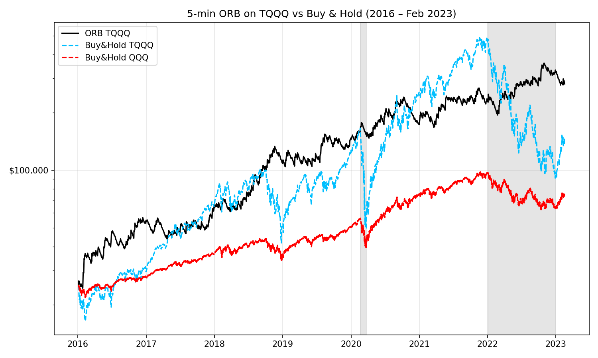
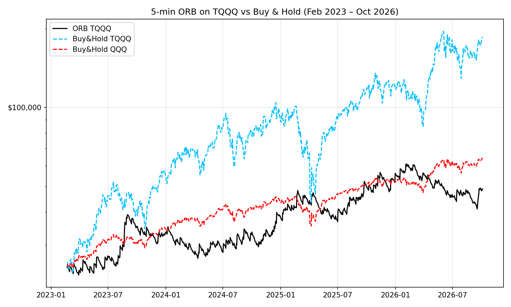

# ORB backtesting on TQQQ

A reproduction of the 5-minute Opening Range Breakout (ORB) day-trading strategy from the paper below, followed by an out-of-sample test on data the paper never saw.

> Carlo Zarattini and Andrew Aziz (2023), *Can Day Trading Really Be Profitable? Evidence of Sustainable Long-term Profits from Opening Range Breakout (ORB) Day Trading Strategy vs. Benchmark in the US Stock Market.*
> SSRN: https://papers.ssrn.com/abstract=4416622

The paper PDF is not stored in this repository because it is the authors' copyrighted work. Download it from the SSRN link above.

## The strategy

One trade per day on TQQQ, using 5-minute bars:

1. Look at the first candle of the session (09:30–09:35).
   - If it closes above its open, go **long**. If it closes below, go **short**. If it is flat, skip the day.
2. Enter at the open of the second candle (09:35).
3. Place the stop at the low of the first candle (long) or its high (short). The distance from entry to stop is the risk, `R`.
4. Take profit at `10R`. If neither stop nor target is hit, exit at the close of the day.
5. Size the position so that a stop-out loses 1% of the account, capped at 4x leverage.

Starting capital is $25,000 and commission is 0.001% of traded value.

## Files

| File | What it is |
|---|---|
| `backtest.py` | The reproduction: ORB on TQQQ, Jan 2016 – 17 Feb 2023, compared with buy-and-hold TQQQ and QQQ |
| `update.py` | The same rules on new data, 21 Feb 2023 onwards. Downloads the data itself |
| `orb_stocks.py` | The same rules on 18 other tickers over the new period |
| `test.py` | Small script used to check the session times in the data |
| `TQQQ_5min.csv`, `QQQ_5min.csv` | 5-minute bars, 2016 – Feb 2023, regular session only |
| `TQQQ_daily.csv`, `QQQ_daily.csv` | Daily bars for the same period |
| `TQQQ_5min_new.csv` | 5-minute TQQQ bars, 21 Feb 2023 – 5 Oct 2026 (from Alpaca, split-adjusted) |
| `orb_stocks_results.csv` | Result table produced by `orb_stocks.py` |
| `orb_equity.png`, `orb_equity_update.png` | Equity curves for the two periods |
| `OpeningRangeBreakout.html` | Interactive chart from an early attempt with the `backtesting` library |

All CSVs have the columns `timestamp, Open, High, Low, Close, Volume`, with timestamps in New York time.

## Results

### Paper period, Jan 2016 – Feb 2023 (`backtest.py`)

| | Total Return | Yearly Return | Volatility | Sharpe | Max Drawdown |
|---|---|---|---|---|---|
| ORB TQQQ | 1,037% | 41% | 38% | 1.08 | 31% |
| Buy & Hold TQQQ | 442% | 27% | 70% | 0.70 | 82% |
| Buy & Hold QQQ | 194% | 16% | – | – | 37% |

$25,000 grew to $281,438 over 1,745 trades. The win rate was 24%, and the average trade made +0.17R. The paper reports a higher total for the same strategy; the difference most likely comes from the data source and fill assumptions.



### After the paper, Feb 2023 – Oct 2026 (`update.py`)

| | Total Return | Yearly Return | Volatility | Sharpe | Max Drawdown |
|---|---|---|---|---|---|
| ORB TQQQ | 98% | 21% | 36% | 0.70 | 33% |
| Buy & Hold TQQQ | 645% | 74% | 59% | 1.23 | 58% |
| Buy & Hold QQQ | 157% | 30% | 20% | 1.42 | 23% |

$25,000 grew to $48,958 over 888 trades. The win rate was 25%, and the average trade made +0.10R. The strategy stayed profitable but fell well behind buy-and-hold.



### Why the gap closed

| TQQQ | 2016 – Feb 2023 | Feb 2023 – Oct 2026 |
|---|---|---|
| Buy-and-hold return per year | 27% | 72% |
| Buy-and-hold max drawdown | 82% | 58% |
| ORB profit per year, in R | 42R | 25R |
| Days moving more than 4% open-to-close, per year | 49 | 34 |
| Trades hitting the 10R target, per year | 6.3 | 4.1 |

- Before 2023, holding TQQQ was a weak benchmark: it included the 2018, 2020 and 2022 sell-offs, where ORB made money on the short side.
- After 2023, most of TQQQ's gain came overnight (about 55% a year from close to open, against 11% from open to close). An intraday strategy cannot capture overnight gaps.
- There were fewer large intraday trend days, which is where the big winners come from.

### Other tickers, Feb 2023 – Oct 2026 (`orb_stocks.py`)

The same rules on 18 tickers gave an average of +0.05R per trade. Eight tickers earned about +0.10R (NVDA, MSFT, SOXL, QQQ, NFLX, MSTR, TQQQ, TSLA), five were near zero, and three lost clearly (META, PLTR, AAPL). ORB beat buy-and-hold only on NFLX, TSLA and SQQQ, the tickers where holding did poorly. The full table is in `orb_stocks_results.csv`.

## How to run

```bash
pip install pandas matplotlib backtesting
python3 backtest.py
```

`update.py` and `orb_stocks.py` download data from [Alpaca](https://alpaca.markets) and need a free API key. Create a file named `.env` next to the scripts:

```
ALPACA_API_KEY=your_key
ALPACA_SECRET_KEY=your_secret
```

Then run:

```bash
python3 update.py
python3 orb_stocks.py
```

Without a key, `update.py` falls back to Yahoo Finance, which only provides the last 60 days of 5-minute bars. `.env` is listed in `.gitignore` and must never be committed.

## Known limitations

- **Intrabar order:** if a single 5-minute bar touches both the stop and the target, the backtest assumes the stop was hit first.
- **No slippage:** stops and targets fill at their exact price.
- **QQQ volatility and Sharpe in `backtest.py`:** these are computed on 5-minute returns but annualised as if daily, so they are left out of the table above. `update.py` uses daily closes.
- **Adjustments:** the 2016–2023 files appear to be adjusted for splits and dividends, while the new file is adjusted for splits only. This does not affect the intraday trades, but it slightly understates buy-and-hold in the new period.
- **Half days:** the new data keeps a full 09:30–15:55 window on early-close days, so the afternoon bars on those days are thin after-hours trading.
- **ORB rows in the tables** are measured from the end of the first trading day, so their total return differs slightly from the dollar figures quoted below each table.

## Disclaimer

This is a research exercise, not investment advice. Backtested results do not predict future returns.
